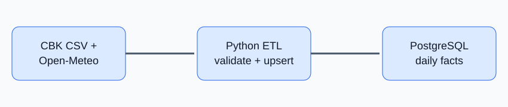

# Kenya Rates & Weather ETL



A batch ETL demo that loads daily Open-Meteo archive observations and exchange rates into PostgreSQL. The weather source is live; the CBK adapter accepts a configured CSV export. If no CBK CSV URL is configured, clearly labelled synthetic FX values keep the demo runnable.

## Run
```bash
cp .env.example .env
docker compose up --build
```
Postgres is exposed at `localhost:5433`. The app loads the last three completed days. Backfill:
```bash
docker compose run --rm app python -m app.main --start 2026-10-01 --end 2026-10-07
```
Test: `pip install -r requirements.txt && pytest`.

## Source contract
CBK CSV must contain `date,currency,rate` with ISO dates. Do not assume CBK has a stable public JSON API; verify the current official download format and terms before configuring it.

## Design decisions
PostgreSQL stores durable observations; natural-key upserts make reruns safe. Open-Meteo is used for a free weather demonstration. The CBK adapter is isolated because source formats can change. Scheduling is intentionally external (cron/GitHub Actions) to keep the local project simple; orchestration can be added later.
